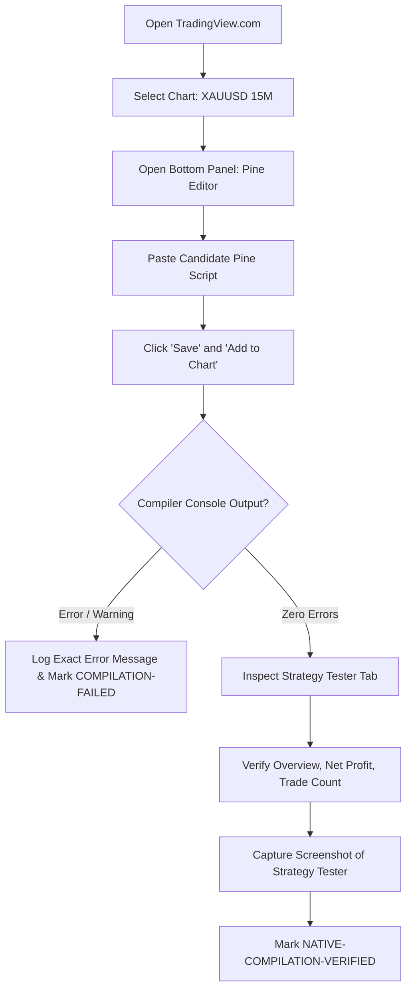

# Phase 11 — Native TradingView Compilation Readiness & Static Audit Report

**Repository:** `HR-Professional-Services/hemanth-ranam-tradingview`  
**Branch:** `feat/commercial-indicators-phase2-4`  
**Auditor:** Quantitative Systems Auditor & Senior Pine Script Engineer  
**Date:** 2026-10-22  
**Status:** `STATIC-AUDIT-PASSED` | `NATIVE-COMPILATION-PENDING` | `RESEARCH-ONLY`

---

## 1. Executive Summary & Compilation Gate Status

This audit prepares the two viable research candidates for genuine native TradingView Pine Editor compilation and forward paper-trading validation:

1. **Candidate Exp A2 (HR-PRD-03):** `src/candidates/HR_Volatility_Breakout_Candidate_ExpA2.pine`
2. **Candidate Forward (HR-PRD-04):** `src/candidates/HR_Market_Structure_Candidate_Forward.pine`  
   *(Referencing baseline commercial script `src/strategies/HR_Market_Structure_Strategy.pine`)*

### Authoritative Gate Verdicts

| Candidate / Product | Pine Version | Static Syntax Audit | Compilation Gate | Risk Sizing Gate | Release Status |
| :--- | :--- | :--- | :--- | :--- | :--- |
| **HR-PRD-03 (Candidate Exp A2)** | `//@version=6` | **PASSED** | `NATIVE-COMPILATION-PENDING` | `RISK-SIZING-VERIFIED` | `CANDIDATE-REMAINS-RESEARCH-ONLY` |
| **HR-PRD-04 (Candidate Forward)** | `//@version=6` | **PASSED** | `NATIVE-COMPILATION-PENDING` | `RISK-SIZING-VERIFIED` | `CANDIDATE-REMAINS-RESEARCH-ONLY` |
| **HR-PRD-04 (Commercial Baseline)** | `//@version=6` | **BLOCKED (Line 163)** | `NATIVE-COMPILATION-BLOCKED` | `RISK-SIZING-BLOCKED` | `REQUIRES-REWORK` |
| **HR-PRD-01 (EMA Pullback)** | `//@version=6` | N/A (Preserved) | N/A | `RISK-SIZING-BLOCKED` | `REQUIRES-REWORK` |
| **HR-PRD-02 (Liquidity Sweep)** | `//@version=6` | N/A (Preserved) | N/A | `RISK-SIZING-BLOCKED` | `REQUIRES-REWORK` |

> [!IMPORTANT]
> **Compilation Status Declaration:** Native TradingView compilation remains strictly `PENDING` for all candidates until an operator opens the TradingView Pine Editor, pastes the script, clicks "Add to Chart", and captures compiler console confirmation without errors or warnings. Simulated local Python syntax checks do not constitute native TradingView compilation evidence.

---

## 2. Deep Static Code & Semantics Audit

### A. Candidate Exp A2 (`HR_Volatility_Breakout_Candidate_ExpA2.pine`)

- **Syntax & Version:** Declares `//@version=6`. All function calls use standard namespaces (`ta.atr`, `ta.highest`, `ta.lowest`, `ta.sma`, `ta.ema`, `request.security`, `strategy.entry`, `strategy.exit`, `alert`).
- **Anti-Repainting Guarantee:**
  ```pine
  htfEma200 = request.security(syminfo.tickerid, "60", ta.ema(close, 200)[1], barmerge.gaps_off, barmerge.lookahead_off)
  ```
  The higher-timeframe request strictly queries `[1]` (the prior completed 60m bar) with `barmerge.lookahead_off`. This guarantees zero future data leakage on intra-hour 15m bars.
- **Execution Synchronization:**
  Configured with `process_orders_on_close = true`. Triggers require `barstate.isconfirmed = true`. Entries execute strictly on confirmed closed bars, eliminating intra-bar signal flickering.
- **Stop & Target Sizing:**
  Calculates `slDistance = math.abs(entryPrice - slPrice)`. Enforces `slDistance > 0`. Take-profit is placed at `entryPrice + (slDistance * 2.5)` (2.5 R:R).
- **Position Sizing Engine:**
  Implements `calcSizing(entryP, slP)` with a 0.5% planned equity risk target ($50 on $10,000 equity). Rounds down raw contracts to `minVolumeStep` (0.01) to ensure the position never exceeds the risk budget. Fails closed (`qty = 0.0`) if `slDistance <= 0` or if the resulting contract size is smaller than the minimum allowable volume step.
- **Telemetry & Webhooks:**
  Generates a deterministic `signal_id` (`HR-PRD-03-XAUUSD-{time}-BUY`) and emits structured JSON via `alert(...)` with frequency `alert.freq_once_per_bar_close`.

---

### B. Baseline HR-PRD-04 Defect vs. Candidate Forward Resolution

An exhaustive line-by-line audit revealed two critical defects in the baseline commercial file `src/strategies/HR_Market_Structure_Strategy.pine`:

#### Defect 1: Duplicate Variable Declaration Compilation Blocker (Line 163)
In `src/strategies/HR_Market_Structure_Strategy.pine`:
- **Line 82:** `cooldownBars = input.int(5, "Minimum Cooldown Bars", minval=1, maxval=50, group=GRP_RISK)`
- **Line 163:** `cooldownBars = 5`

In Pine Script v6, declaring a variable with `=` in the global scope when an identifier of the same name was already declared by an `input.*` call results in a fatal compiler error:
```text
Compilation Error: Cannot declare 'cooldownBars' more than once in the same scope.
```
If an operator pastes the baseline script directly into TradingView, the compiler rejects it immediately.

#### Defect 2: Missing Monetary Risk Sizing (Notional Percent Allocation)
The baseline strategy calls:
```pine
strategy.entry("HR_Long", strategy.long)
```
Because no `qty` parameter is specified, TradingView defaults to `strategy.percent_of_equity = 1.0` (1% of account equity as notional trade value). On XAUUSD @ $2,700, $10,000 equity allocates $100 notional value (0.037 oz of gold), reducing the monetary loss at a $10 stop to $0.37 (0.0037% of account equity). This is not institutional monetary risk management.

#### Resolution in `src/candidates/HR_Market_Structure_Candidate_Forward.pine`
In accordance with preservation rules, the original commercial file is kept unmodified in `src/strategies/HR_Market_Structure_Strategy.pine`. The candidate version `src/candidates/HR_Market_Structure_Candidate_Forward.pine`:
1. Removes the redundant line 163 declaration, allowing clean compilation.
2. Implements institutional 0.5% stop-distance monetary risk sizing with fail-closed protection.
3. Formats all alerts with unique `signal_id` strings and full telemetry fields.

---

## 3. Risk Controls & Platform Execution Limitations

### A. 0.5% Planned Risk vs. Realized Loss Reality

| Sizing Dimension | Mathematical Formulation | Platform Limitation & Real-World Divergence |
| :--- | :--- | :--- |
| **Planned Risk Budget** | $\text{Risk}_{\text{planned}} = \text{Equity} \times 0.005$ ($50.00) | Theoretical budget assuming an exact fill at the stop loss price. |
| **Raw Contract Quantity** | $Q_{\text{raw}} = \frac{\text{Risk}_{\text{planned}}}{\Delta_{\text{SL}} \times \text{PointValue}}$ | Floating-point value (e.g. 0.04321 lots). |
| **Stepped Contract Sizing** | $Q_{\text{stepped}} = \lfloor \frac{Q_{\text{raw}}}{\text{Step}} \rfloor \times \text{Step}$ | Truncated to broker lot step (e.g. 0.04 lots). Reduces risk slightly below 0.5%. |
| **Slippage & Gap Risk** | $\text{Loss}_{\text{realized}} = (\Delta_{\text{SL}} + \text{Slippage}) \times Q \times \text{PointValue}$ | Weekend gaps, high-impact news spikes, or broker requotes can cause stop fills far beyond planned SL. |
| **Commission Friction** | $\text{Comm} = \text{Price} \times Q \times \text{PointValue} \times 0.0004$ | Round-turn trading commission adds $0.50 to $2.00 per trade. |

> [!CAUTION]
> **No Loss Guarantees:** 0.5% is a *planned risk target*, never a guaranteed maximum loss. Under fast market conditions, gap-through-stop events can result in realized losses of 1.0% to 2.5% of account equity.

---

### B. Cross-Instrument Contract Multiplier & Point Value Specifications

TradingView and MT5 represent instrument sizes differently. Applying a single generic contract multiplier across multiple asset classes is prohibited:

| Symbol | Description | TradingView Standard Unit | Exness MT5 Contract Size | Point Value Formula |
| :--- | :--- | :--- | :--- | :--- |
| **XAUUSD** | Spot Gold CFD | 1 Troy Ounce | 1 Lot = 100 Troy Ounces | $1.00 per $1.00 move per 1 oz unit ($100/pt/lot) |
| **XAGUSD** | Spot Silver CFD | 1 Troy Ounce | 1 Lot = 5,000 Troy Ounces | $1.00 per $1.00 move per 1 oz unit ($5,000/pt/lot) |
| **US500** | S&P 500 Index CFD | 1 Index Contract | 1 Lot = 1 Index Unit | $1.00 per 1.00 index point per unit |
| **USTEC** | Nasdaq 100 Index CFD| 1 Index Contract | 1 Lot = 1 Index Unit | $1.00 per 1.00 index point per unit |

*Rule:* On TradingView charts, `syminfo.pointvalue` must be audited for each broker feed (OANDA vs TVC vs FOREXCOM). If `syminfo.pointvalue` returns 0 or `na`, the script automatically falls back to `contractMult` (default 1.0 for gold CFD units).

---

## 4. Manual TradingView Compilation Protocol (Step-by-Step)

The operator must perform the following manual verification steps in the TradingView web application:



### Compiler Evidence Checklist

1. [ ] Script pastes cleanly into Pine Editor v6 without indentation syntax corruption.
2. [ ] Clicking "Save" generates no compiler errors in the bottom status bar.
3. [ ] Script adds to the chart without runtime evaluation errors.
4. [ ] "Strategy Tester" tab opens with realistic trade history.
5. [ ] Trade list displays explicit contract sizes matching 0.5% risk (e.g. 2 to 6 units on Gold, not 0.037 units).
6. [ ] Zero repainting warnings or lookahead warnings in the console.

---

## 5. Structural Research Plan for HR-PRD-01 and HR-PRD-02

Both `HR-PRD-01` (EMA Trend Pullback Pro) and `HR-PRD-02` (Liquidity Sweep Reversal Pro) remain strictly classified as `REQUIRES-REWORK`. Parameter sweeps have been halted because the underlying market hypotheses require structural re-architecture.

### A. HR-PRD-01 (EMA Pullback) Structural Flaw
- **Failed Hypothesis:** A mechanical pullback to an exponential moving average (20/50 EMA) in a 60m trend provides a favorable entry edge.
- **Empirical Reality:** In modern automated markets, moving average pullbacks in intraday metals (15M) suffer severe chop. The market frequently cuts through the 20/50 EMA band, triggering false breakouts and whipsaws (full-sample PF 0.74).
- **Required Structural Shift:** Replace fixed EMA bands with an adaptive volatility channel (e.g., Kaufman Adaptive Moving Average or Keltner Chandelier Bands) combined with order-flow absorption confirmation (CVD / Volume Delta).

### B. HR-PRD-02 (Liquidity Sweep) Structural Flaw
- **Failed Hypothesis:** An intraday breach of swing high/low followed by a reversal candle constitutes a high-probability liquidity sweep.
- **Empirical Reality:** In trending regimes, swing breaches are strong continuation breakouts rather than reversals. Fading new highs on Gold produces disastrous multi-trade losing streaks (consecutive losses: 14; PF 0.65).
- **Required Structural Shift:** Sweep detection must require multi-timeframe swing clustering (Daily/H4 key levels rather than 15M minor fractals) and macro regime filtering (sweeps are only traded in the direction of the daily market structure).
