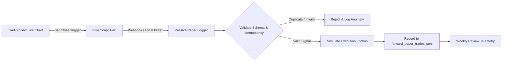

# Phase 11 — Blind Forward Paper-Trading Protocol & Telemetry Standard

**System:** HR TradingView Commercial Portfolio  
**Protocol Version:** 1.0.0 (Phase 11 Release)  
**Lead Quantitative Engineer:** Hemanth Ranam  
**Auditor:** Antigravity Quantitative Research Engine  
**Start Date (Frozen):** 2026-10-23 00:00:00 UTC  
**Evaluation Scope:** Blind Out-of-Sample Forward Validation on `XAUUSD` (15M)  
**Status:** `PAPER-LOGGER-VERIFIED` | `FORWARD-TEST-ACTIVE` (Upon Native Compiler Verification)

---

## 1. Objective & Fundamental Governance Principles

The purpose of this protocol is to conduct an **uncontaminated, blind forward-testing campaign** on live market data without human intervention or mid-test optimization.

### Strict Governance Rules

1. **Zero Broker Connectivity:** Forward testing uses passive logging or TradingView paper trading. Under no circumstances may real broker API keys, live accounts, or real capital be connected to this logging pipeline.
2. **Absolute Configuration Freeze:** Parameter sets are mathematically frozen as of commit `faee296` + Phase 11 candidate definitions. Any parameter modification invalidates the forward testing period and resets the evaluation clock to Day 0.
3. **Strict Instrument Isolation:** Results on Gold (`XAUUSD`) must never be pooled, averaged, or cross-subsidized with Silver (`XAGUSD`), S&P 500 (`US500`), or Nasdaq 100 (`USTEC`).
4. **Idempotency & Replay Protection:** Inbound alerts are keyed by a unique deterministic `signal_id`. Duplicate alerts caused by network retries or platform glitches are immediately flagged and rejected.
5. **No Commercial Promotion Based on Small Samples:** A profitable forward run of 10 to 20 trades will NOT qualify a strategy for commercial release. Statistical uncertainty must be quantified before release gates can open.

---

## 2. Frozen Candidate Configurations

Both candidates operate on **XAUUSD (15-minute timeframe)** with a **10,000 USD simulated starting balance** and **0.5% planned equity risk per trade**.

### Candidate 1: HR-PRD-03-CANDIDATE-EXPA2 (Volatility Breakout Pro)

- **Source File:** `src/candidates/HR_Volatility_Breakout_Candidate_ExpA2.pine`
- **Candidate ID:** `HR-PRD-03-CANDIDATE-EXPA2`
- **Core Strategy:** Volatility Squeeze Breakout with 60M HTF 200 EMA Filter.
- **Frozen Inputs:**
  - `boxLookback = 20` (Consolidation high/low boundary)
  - `squeezeThreshold = 2.20` (Box range <= 2.2 ATR)
  - `requireVolume = true`, `minVolumeMult = 1.10`
  - `useMonetarySizing = true`, `riskPercent = 0.5%` ($50 budget on $10,000)
  - `rrMultiplier = 2.5` (Take profit = 2.5 × Stop Distance)
  - `slBufferAtr = 0.20` (Stop placed at box midpoint ± 0.2 ATR)
  - `cooldownBars = 5` (Minimum bars between breakout trades)
  - `contractMult = 1.0` (1 unit = 1 troy oz)
  - `minVolumeStep = 0.01` (Minimum contract step)
  - `maxRiskUsdCap = 100.0` (Hard dollar cap)
  - `process_orders_on_close = true`

### Candidate 2: HR-PRD-04-CANDIDATE-FORWARD (Market Structure Momentum Pro)

- **Source File:** `src/candidates/HR_Market_Structure_Candidate_Forward.pine`
- **Candidate ID:** `HR-PRD-04-CANDIDATE-FORWARD`
- **Core Strategy:** Structural Break of Structure (BOS) with RSI Momentum & 60M HTF 200 EMA.
- **Frozen Inputs:**
  - `pivotStrength = 3` (3 bars left, 3 bars right fractal swing)
  - `lookbackWindow = 40` (Maximum bars for active swing reference)
  - `rsiPeriod = 14`, `bullishRsiMin = 53.0`, `bearishRsiMax = 47.0`
  - `useHtfFilter = true`, `htfTF = "60"`, `htfEmaLen = 200`
  - `minEntryScore = 70`, `minSignalGrade = "A and Above"`
  - `atrLen = 14`, `slBufferAtr = 0.15`
  - `rrMultiplier = 2.4` (Take profit = 2.4 × Stop Distance)
  - `cooldownBars = 5` (Clean scope without duplicate declaration)
  - `useMonetaryRisk = true`, `riskPercent = 0.5%` ($50 budget on $10,000)
  - `contractMult = 1.0` (1 unit = 1 troy oz)
  - `minVolumeStep = 0.01` (Minimum contract step)
  - `maxRiskUsdCap = 100.0` (Hard dollar cap)
  - `process_orders_on_close = true`

---

## 3. Passive Telemetry & Logging Architecture



### A. Telemetry Webhook JSON Payload

Every alert emitted by the candidates adheres strictly to the following specification:

```json
{
  "brand": "Hemanth Ranam",
  "candidate_id": "HR-PRD-03-CANDIDATE-EXPA2",
  "signal_id": "HR-PRD-03-XAUUSD-1730000000000-BUY",
  "symbol": "XAUUSD",
  "timeframe": "15",
  "bar_time": 1730000000000,
  "direction": "BUY",
  "entry_price": 2720.50,
  "stop_loss": 2710.50,
  "take_profit": 2745.50,
  "planned_risk_pct": 0.5,
  "planned_risk_usd": 50.0,
  "qty": 5.0,
  "exit_reason_planned": "R_MULTIPLE_2.5"
}
```

### B. Execution Friction Modeling
The paper logger (`research/forward_test/paper_trade_logger.py`) computes simulated fills by applying institutional friction:
- **Slippage:** 2 ticks ($0.02/oz on Gold) applied adversely to entry and exit fills.
- **Commission:** 0.02% of trade notional value per side (0.04% round-turn).
- **Net Simulated PnL:** Accounts for realized stop distance, slippage on stop triggers, and broker commission.

---

## 4. Review Milestones & Circuit Breakers

### A. Milestone Review Gates

| Milestone | Criterion | Purpose |
| :--- | :--- | :--- |
| **Check-in 1** | 14 calendar days or 15 trades | Early verification of alert reliability, zero missing alerts, sizing conformity. |
| **Check-in 2** | 30 calendar days or 30 trades | Mid-term equity curve check, consecutive loss tracking, drift analysis. |
| **Final Review** | **60 calendar days AND minimum 50 trades** | Comprehensive bootstrap uncertainty analysis, profit factor, and release evaluation. |

### B. Early-Stop Circuit Breakers (Automatic Suspension)
A candidate is immediately suspended from forward testing if it triggers either of these risk circuit breakers:
1. **Consecutive Losses:** 12 consecutive stopped trades.
2. **Peak-to-Trough Drawdown:** Account equity declines by >= 10.0% ($1,000 on $10,000 balance).

Triggering a circuit breaker flags the candidate as `ROBUSTNESS-FAILED` and permanently halts live deployment.

---

## 5. Outage Handling & Discrepancy Reconciliation

If an alert is missed due to a network dropout or webhook interruption:
1. **Reconciliation Source:** TradingView's "Strategy Tester" -> "List of Trades" serves as the authoritative ground truth for simulated fills.
2. **Audit Check:** Compare the timestamps in `research/forward_test/logs/forward_paper_trades.jsonl` against the TradingView Strategy Tester list.
3. **Manual Insertion Rule:** Any missing signal must be marked with `"status": "MANUAL_RECONCILED"` and flagged in the audit notes. Never fabricate missing fills or retroactively modify prices.
