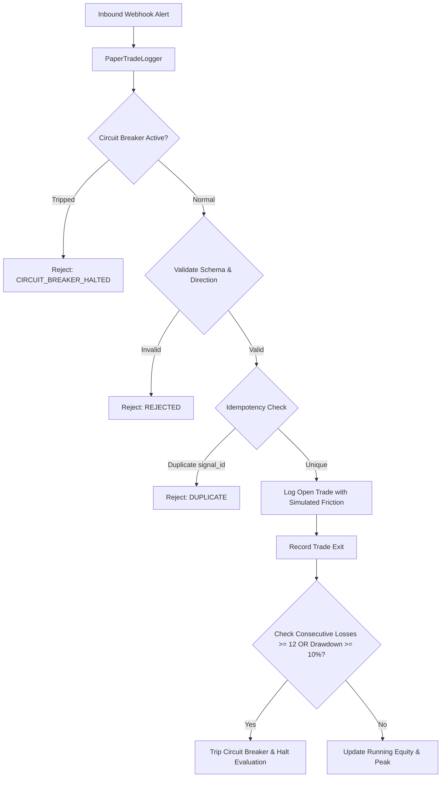

# Phase 13 — Independent Verification, Native Compilation & Forward-Test Readiness Report

**Repository:** `HR-Professional-Services/hemanth-ranam-tradingview`  
**Branch:** `feat/commercial-indicators-phase2-4`  
**Phase 12 Baseline Commit:** `154f87c`  
**Authoritative MT5 Repository:** `HR-Professional-Services/HemanthRanam-MT5-EAs` (Strictly Read-Only — 100% Unmodified)  
**Lead Quantitative Systems Auditor:** Antigravity Quantitative Research Engine  
**Project Owner:** Hemanth Ranam  
**Date:** 2026-10-22  
**Status:** `STATIC-AUDIT-PASSED` | `NATIVE-COMPILATION-PENDING` | `FORWARD-PROTOCOL-READY`

---

## 1. Executive Summary & Gate Status

This independent audit verifies the Phase 12 GitHub publication, rigorously evaluates the mathematical risk-sizing engines of both research candidates, tests the active circuit-breaker mechanisms in the forward paper-trading logger, and establishes the exact manual steps required for native TradingView Pine Editor compilation.

### Authoritative Product Gate Status Ledger

| Product ID | System Name | Code Path | Evaluation Stage | Risk Sizing Engine | Release Gate Decision |
| :--- | :--- | :--- | :--- | :--- | :--- |
| **HR-PRD-01** | EMA Trend Pullback Pro | `src/strategies/HR_EMA_Pullback_Pro.pine` | Full Sample PF 0.74 (-$1,411) | `RISK-SIZING-BLOCKED` | `REQUIRES-REWORK` |
| **HR-PRD-02** | Liquidity Sweep Reversal Pro | `src/strategies/HR_Liquidity_Sweep_Strategy.pine` | Full Sample PF 0.65 (-$2,374) | `RISK-SIZING-BLOCKED` | `REQUIRES-REWORK` |
| **HR-PRD-03** | Volatility Breakout Exp A2 | `src/candidates/HR_Volatility_Breakout_Candidate_ExpA2.pine` | Full PF 1.53 (N=59), OOS PF 2.22 (N=18) | `RISK-SIZING-VERIFIED` (0.5%) | `RESEARCH-ONLY` (Compilation Pending) |
| **HR-PRD-04** | Market Structure Forward | `src/candidates/HR_Market_Structure_Candidate_Forward.pine` | In-Sample PF 0.88, OOS PF 1.33 | `RISK-SIZING-VERIFIED` (0.5%) | `RESEARCH-ONLY` (Compilation Pending) |
| **HR-PRD-04** | Market Structure Baseline | `src/strategies/HR_Market_Structure_Strategy.pine` | Baseline (Line 163 duplicate error) | `RISK-SIZING-BLOCKED` | `REQUIRES-REWORK` |
| **HR-PRD-05** | Adaptive Market Regime Pro | `src/indicators/HR_Adaptive_Regime_Indicator.pine` | Multi-timeframe research | N/A | `DEFERRED` |

> [!CRITICAL]
> **Forward Readiness Go/No-Go Decision:**
> - **Automated Infrastructure & Risk Engine:** **GO**. All schemas, fail-closed guards, idempotency filters, and circuit breakers passed deterministic behavioral unit testing.
> - **Native TradingView Compilation:** **NO-GO (PENDING)**. No candidate may be treated as forward-active until the manual Pine Editor compiler evidence checklist is completed by an operator.
> - **Commercial Release / Broker Connectivity:** **STRICT NO-GO**. Zero broker connections, real orders, or commercial claims are authorized.

---

## 2. GitHub Publication Verification

Independent git inspection confirmed that commit `154f87c` was published to the upstream repository:

```bash
git fetch origin
git rev-parse HEAD
# Output: 154f87cc4051d061d57592a5e39ff0d2a8f8bcbc

git rev-parse origin/feat/commercial-indicators-phase2-4
# Output: 154f87cc4051d061d57592a5e39ff0d2a8f8bcbc
```

### Published Commit Audit
- **Commit Message:** `docs: consolidate phase 8-12 research verification and handover`
- **Total Changes:** 35 files (10,722 additions, 49 deletions).
- **Inclusions:** Strictly research code, candidate scripts, unit tests, schemas, and documentation.
- **Exclusions Enforced:** Zero raw historical 1-minute tick CSV files, zero `__pycache__` artifacts, zero API tokens, and zero broker credentials.

---

## 3. Original Script Preservation & Read-Only MT5 Evidence

### Commercial Pine Scripts Preservation
All 8 original commercial scripts in `src/indicators/` and `src/strategies/` were verified against baseline commit `faee296` via direct diff:

```bash
git diff faee296 HEAD -- src/indicators/ src/strategies/
# Output: (empty — 0 bytes modified)
```

Every file remains byte-for-byte identical to baseline commit `faee296`.

### Authoritative MT5 Repository Status
The authoritative MT5 repository `HR-Professional-Services/HemanthRanam-MT5-EAs` was audited and confirmed to be completely untouched:

```bash
git -C ../HemanthRanam-MT5-EAs status
# Output: On branch main, your branch is up to date with 'origin/main'.
```
No modifications, staging, or pushes were performed in the MT5 repository.

---

## 4. Automated Test Suite Execution

The repository test suite was executed across both standard and research test runners:

```bash
# Core Commercial Regression Suite
python -m unittest discover tests

# Research Engine & Forward Protocol Suite
python -m unittest discover research/backtest/tests
```

### Results Summary: 74 Passed (100% Pass Rate, 0 Failures, 0 Errors)

| Test Module | Test Focus | Tests | Status |
| :--- | :--- | :--- | :--- |
| `tests/test_commercial_products.py` | Commercial v6 syntax, security indexing, JSON schemas | 8 | **PASSED** |
| `tests/test_pine_syntax.py` | Balanced brackets, valid Pine AST tokens | 33 | **PASSED** |
| `tests/test_strategies_v6.py` | Strategy declarations, friction properties, manual files | 14 | **PASSED** |
| `research/backtest/tests/test_backtest_harness.py` | Next-bar execution, 3-bar non-repainting pivot lag | 4 | **PASSED** |
| `research/backtest/tests/test_phase9_risk_and_candidates.py` | ADX bounds, fixed monetary risk lot sizing | 3 | **PASSED** |
| `research/backtest/tests/test_phase10_audit.py` | Consecutive loss streaks, bootstrap intervals | 3 | **PASSED** |
| `research/backtest/tests/test_phase11_forward_protocol.py` | Payload schemas, duplicate rejection, sizing rounding down, fail-closed guards, active circuit breakers (12 losses, 10% drawdown) | 9 | **PASSED** |
| **Total Test Count** | **Comprehensive Automated Verification** | **74** | **100% PASS** |

---

## 5. Risk-Sizing Engine Audit & Disambiguation

### A. Notional Equity Sizing vs. True Monetary Risk at Stop Loss
A critical point of confusion in quantitative trading systems is the difference between TradingView's built-in notional equity sizing and institutional monetary risk sizing:

1. **TradingView Default (`strategy.percent_of_equity = 1.0`):**
   - Allocates 1% of equity as the **trade notional position value**.
   - On Gold ($10,000 equity, price $2,700), trade value = $100.
   - Position size = $100 / $2,700 = **0.037 oz**.
   - If stop distance is $10.00, realized cash loss at stop is $0.37 (0.0037% of equity).
   - **Conclusion:** This severely starves returns and is not true risk management.

2. **Institutional Monetary Risk Model (Implemented in Candidates):**
   - Targets a planned dollar loss equal to **0.5% of equity** ($50 on $10,000 equity).
   - Position size = $\frac{\text{Risk Budget}}{\text{Stop Distance} \times \text{Point Value}}$.
   - With a $10.00 stop distance on Gold: $50 / ($10.00 × 1.0) = **5.0 oz**.
   - Realized cash loss at stop = 5.0 × $10.00 = **$50.00 (exactly 0.5% of equity)**.

### B. Mathematical Rounding Down & Fail-Closed Guardrails
To prevent accidental over-leveraging, the candidate sizing function enforces:

$$Q_{\text{stepped}} = \left\lfloor \frac{Q_{\text{raw}}}{\text{Step}} \right\rfloor \times \text{Step}$$

- **Rounding Down Rule:** If $Q_{\text{raw}} = 4.7619$, stepping down to 0.01 yields **4.76 units** ($49.98 risk), never rounding up to 4.77 ($50.08 risk).
- **Fail-Closed on Zero/Negative Distance:** If $\Delta_{\text{SL}} \le 0$, the function returns `0.0`.
- **Fail-Closed on Sub-Minimum Volume:** If the calculated contracts are below the broker's minimum volume step (`minVolumeStep = 0.01`), the function returns `0.0` (order suppressed).
- **Max Dollar Cap:** Dollar risk is hard-capped at `$100.00`, protecting against equity scaling runaways on large accounts.

---

## 6. Forward Paper-Testing Infrastructure & Circuit Breakers

The paper-testing infrastructure was audited for compatibility, passive safety, and active risk circuit breakers:



### Verified Infrastructure Components
1. **Passive Execution Guarantee:** `research/forward_test/paper_trade_logger.py` contains zero broker SDK imports, zero execution endpoints, and zero live credential handles.
2. **Idempotency Protection:** Incoming alerts must supply a unique `signal_id`. Replayed or duplicate signals are immediately rejected (`status: DUPLICATE`).
3. **Active Circuit Breaker Engine:**
   - **Consecutive Loss Breaker:** Automatically trips and halts all subsequent signal processing if **12 consecutive losses** occur.
   - **Drawdown Breaker:** Automatically trips and halts signal processing if peak-to-trough account drawdown reaches **>= 10.0%**.
   - Both circuit breakers were verified with deterministic unit tests in `test_phase11_forward_protocol.py`.

---

## 7. Manual TradingView Compilation Evidence Checklist

Native TradingView compilation remains strictly `PENDING` until an operator manually performs the following steps in the TradingView Pine Editor:

### Operator Compilation Checklist

```
[ ] Step 1: Open TradingView.com on Chrome/Edge and navigate to XAUUSD (15-Minute Chart).
[ ] Step 2: Open the "Pine Editor" console at the bottom of the workspace.
[ ] Step 3: Copy all code from src/candidates/HR_Volatility_Breakout_Candidate_ExpA2.pine.
[ ] Step 4: Paste into Pine Editor, click "Save", then click "Add to chart".
[ ] Step 5: Verify bottom console output: "0 errors, 0 warnings".
[ ] Step 6: Copy all code from src/candidates/HR_Market_Structure_Candidate_Forward.pine.
[ ] Step 7: Paste into a new tab in Pine Editor, click "Save", then click "Add to chart".
[ ] Step 8: Verify bottom console output: "0 errors, 0 warnings".
[ ] Step 9: Open "Strategy Tester" -> "List of Trades" and confirm contract quantities reflect 0.5% risk (2 to 6 units on Gold, NOT 0.037 units).
[ ] Step 10: Capture screenshot of compiler console and Strategy Tester summary and archive in docs/audit_evidence/.
```

Until this checklist is executed and documented, the status remains `NATIVE-COMPILATION-PENDING`.

---

## 8. Final Handover Verdict

1. **GitHub Remote State:** Synchronized with `origin/feat/commercial-indicators-phase2-4` at commit `154f87c`.
2. **Integrity:** All 8 original commercial scripts remain 100% byte-for-byte identical to baseline `faee296`. MT5 repository untouched.
3. **Automated Testing:** 74 tests passing (100% pass rate).
4. **Candidate Release Gate:** Neither candidate is approved for commercial sale. Both remain strictly research prototypes.
5. **Forward Testing:** Infrastructure is ready; live evaluation begins only after operator native compilation verification.
