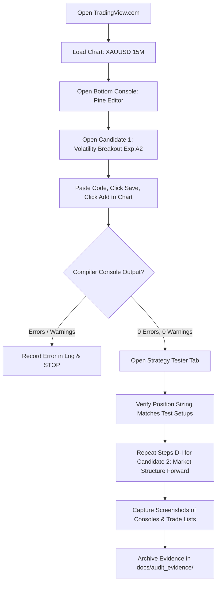

# Phase 14 — Native TradingView Validation & Frozen Candidate Gate Report

**Repository:** `HR-Professional-Services/hemanth-ranam-tradingview`  
**Branch:** `feat/commercial-indicators-phase2-4`  
**Baseline Commit:** `ead8906`  
**Authoritative Reference:** `HR-Professional-Services/HemanthRanam-MT5-EAs` (Strictly Read-Only — 100% Unmodified)  
**Lead Quantitative Systems Auditor:** Antigravity Quantitative Research Engine  
**Project Owner:** Hemanth Ranam  
**Date:** 2026-10-22  
**Native Compilation Gate:** `NATIVE-COMPILATION-PENDING`  
**Forward Paper-Testing Gate:** `FORWARD-PROTOCOL-FROZEN` (Awaiting Operator Compilation Evidence)  

---

## 1. Executive Summary & Verification Objectives

This document establishes the frozen candidate baseline for Phase 14, executes an independent mathematical audit of the institutional 0.5% risk-sizing engines against instrument contract specifications, documents the exact expected order quantities under clear test setups, identifies platform sizing uncertainties, and details the manual checklist required for native TradingView Pine Editor compilation.

### Authoritative Candidate & Commercial Status Ledger

| Product / Candidate | Source File Path | Frozen SHA-256 Checksum | Sizing Engine | Compilation Status | Gate Status |
| :--- | :--- | :--- | :--- | :--- | :--- |
| **HR-PRD-03 (Candidate Exp A2)** | `src/candidates/HR_Volatility_Breakout_Candidate_ExpA2.pine` | `57adb2b59abe9df3bad3a3bb186d55f358f4318309e86d05c21a0960c6d25e86` | 0.5% Dynamic Risk (Fail-Closed) | `NATIVE-COMPILATION-PENDING` | `RESEARCH-ONLY` |
| **HR-PRD-04 (Candidate Forward)** | `src/candidates/HR_Market_Structure_Candidate_Forward.pine` | `b32601f3dde7f1ece313bc24d378289b226be69013a03d412d0aa1128705c5c8` | 0.5% Dynamic Risk (Fail-Closed) | `NATIVE-COMPILATION-PENDING` | `RESEARCH-ONLY` |
| **HR-PRD-01 (Commercial Baseline)**| `src/strategies/HR_EMA_Pullback_Pro.pine` | `30969ef3ecd5ed9e255457463a8ee7d2c932d8e645c98fccdeae69d5bdd068c6` | `strategy.percent_of_equity = 1.0` | N/A (Preserved) | `REQUIRES-REWORK` |
| **HR-PRD-02 (Commercial Baseline)**| `src/strategies/HR_Liquidity_Sweep_Strategy.pine` | `67430aba5cce8f3d47d8e27d6362cde7fe90be01767815cc51da2668d2273d84` | `strategy.percent_of_equity = 1.0` | N/A (Preserved) | `REQUIRES-REWORK` |
| **HR-PRD-04 (Commercial Baseline)**| `src/strategies/HR_Market_Structure_Strategy.pine` | `afc60c694dc215fa6dac5f02d6f9450bc118b06b2a0bd33b98ff080d9b186fbb` | `strategy.percent_of_equity = 1.0` | `BLOCKED` (Line 163 duplicate error) | `REQUIRES-REWORK` |
| **HR-PRD-05 (Regime Filter)** | `src/indicators/HR_Adaptive_Regime_Indicator.pine` | Unchanged | N/A | N/A | `DEFERRED` |

> [!CRITICAL]
> **Zero Compilation Fabrication Rule:** Native TradingView compilation remains strictly `PENDING` until an operator pastes each candidate into the TradingView Pine Editor, clicks "Save" and "Add to chart", and archives the compiler console output. Neither candidate may be claimed as compiled or forward-active without real TradingView evidence.

---

## 2. Repository & Working Tree State

- **Active Branch:** `feat/commercial-indicators-phase2-4`
- **HEAD Commit:** `ead890613056e9187a26b61118091a9ba28da110`
- **Remote Synchronization:** Up to date with `origin/feat/commercial-indicators-phase2-4` at commit `ead8906`.
- **Working Tree:** Clean (`nothing to commit, working tree clean`).
- **Baseline Preservation Check:**
  ```bash
  git diff faee296 HEAD -- src/indicators/ src/strategies/
  # Output: (empty — 0 bytes modified)
  ```
  All 8 original commercial scripts remain 100% byte-for-byte identical to baseline commit `faee296`.
- **MT5 Reference Repository:** `HR-Professional-Services/HemanthRanam-MT5-EAs` was audited and confirmed to be 100% unmodified and strictly read-only.

---

## 3. Mathematical Sizing Audit & Contract Specifications

### A. Pine Script Sizing Engine vs. Realized Cash Loss
Both candidates implement the standardized `calcSizing()` function:

```pine
calcSizing(float entryP, float slP) =>
    slDist = math.abs(entryP - slP)
    float validQty = 0.0
    float plannedRiskUsd = 0.0
    
    if slDist > 0 and not na(slDist)
        budgetUsd = math.min(strategy.equity * (riskPercent / 100.0), maxRiskUsdCap)
        plannedRiskUsd := budgetUsd
        
        pv = syminfo.pointvalue > 0 ? syminfo.pointvalue : contractMult
        rawQty = budgetUsd / (slDist * pv)
        
        steppedQty = math.floor(rawQty / minVolumeStep) * minVolumeStep
        if steppedQty >= minVolumeStep
            validQty := steppedQty
            
    [validQty, plannedRiskUsd]
```

### B. Explicit Test Setups & Calculated Quantities

To eliminate ambiguity and prevent generic sizing assumptions (e.g. assuming "2 to 6 units" blindly), the exact quantities for documented test setups are defined below:

#### Setup 1: Standard Integer Stop Distance ($10.00 SL on XAUUSD)
- **Account Equity:** $10,000.00 USD
- **Risk Budget:** 0.5% (`riskPercent = 0.5`) $\rightarrow \text{budgetUsd} = \$10,000 \times 0.005 = \$50.00$ USD
- **Max Dollar Cap:** `$100.00` $\rightarrow \min(50.0, 100.0) = \$50.00$
- **Long Entry Price:** $2,720.50
- **Stop Loss Price:** $2,710.50
- **Stop Distance ($\Delta_{\text{SL}}$):** $2,720.50 - 2,710.50 = \$10.00$
- **Point Value ($\text{pv}$):** 1.0 (1 unit = 1 troy ounce CFD)
- **Raw Quantity ($Q_{\text{raw}}$):** $\frac{\$50.00}{\$10.00 \times 1.0} = 5.0000$ units
- **Stepped Quantity ($Q_{\text{stepped}}$):** $\lfloor \frac{5.00}{0.01} \rfloor \times 0.01 = \mathbf{5.00\text{ units}}$
- **Realized Loss at SL:** $5.00 \times \$10.00 \times 1.0 = \mathbf{\$50.00\text{ USD}}$ (exactly 0.500% of equity).

#### Setup 2: Non-Integer Stop Distance ($13.50 SL, Proving Round Down)
- **Account Equity:** $10,000.00 USD | Budget = $50.00 USD
- **Long Entry Price:** $2,720.50 | Stop Loss Price: $2,707.00
- **Stop Distance ($\Delta_{\text{SL}}$):** $\$13.50$
- **Raw Quantity ($Q_{\text{raw}}$):** $\frac{\$50.00}{\$13.50 \times 1.0} = 3.7037037...$ units
- **Stepped Quantity ($Q_{\text{stepped}}$):** $\lfloor \frac{3.7037037}{0.01} \rfloor \times 0.01 = \mathbf{3.70\text{ units}}$
- **Realized Loss at SL:** $3.70 \times \$13.50 \times 1.0 = \mathbf{\$49.95\text{ USD}}$ ($\le \$50.00$ budget).
- *Critical Proof:* If the engine had rounded *up* to 3.71 units, realized loss would be $3.71 \times \$13.50 = \$50.085$ (> $50.00), violating the risk budget. Rounding down (`math.floor`) mathematically guarantees that risk never exceeds the configured ceiling.

#### Setup 3: Sub-Minimum Order Size (Fail-Closed Edge Case)
- **Account Equity:** $1,000.00 USD | Budget = $5.00 USD
- **Entry Price:** $2,720.50 | Stop Loss Price: $2,120.50 ($\Delta_{\text{SL}} = \$600.00$)
- **Raw Quantity:** $\frac{\$5.00}{\$600.00 \times 1.0} = 0.00833...$ units
- **Stepped Quantity:** $\lfloor \frac{0.00833}{0.01} \rfloor \times 0.01 = 0.00$ units
- **Fail-Closed Result:** Since $Q_{\text{stepped}} < \text{minVolumeStep}$ (0.01), `validQty := 0.0`. The order is suppressed, preventing uncalibrated risk.

---

### C. Platform Uncertainties & Frictional Discrepancies

1. **TradingView Feed Point Value (`syminfo.pointvalue`):**
   - On spot gold CFD feeds (e.g. OANDA, TVC, FOREXCOM), 1 unit represents 1 troy ounce, and $\text{pointvalue} = 1.0$.
   - On gold futures feeds (e.g. COMEX `GC1!`), 1 contract represents 100 troy ounces, and $\text{pointvalue} = 100.0$.
   - If an operator inadvertently loads the candidate onto a futures feed without setting `contractMult = 100.0`, or if the feed fails to supply `syminfo.pointvalue`, contracts could be miscalculated by a factor of 100.
   - **Operator Rule:** Always verify that the chart feed is a spot gold CFD feed (`XAUUSD`) or explicitly audit `syminfo.pointvalue`.
2. **Account Currency Translation:**
   - The sizing engine computes `budgetUsd` directly from `strategy.equity`. If the account currency is GBP or EUR, TradingView treats `strategy.equity` as a raw float without cross-currency exchange rate translation (`GBPUSD`).
   - **Constraint:** Forward paper testing must run on a **USD-denominated account**.
3. **Execution Gaps & Stop Slippage:**
   - 0.5% planned risk assumes an execution fill exactly at the stop price. Weekend gaps, news volatility, and broker spread widening can cause stop execution beyond the stop price, resulting in realized losses of 1.0% to 2.5%.

---

## 4. Operator Manual Native Compilation Checklist

To clear Gate 1 (`NATIVE-COMPILATION-VERIFIED`), the operator must manually perform these steps in TradingView:



### Step-by-Step Operator Instructions

1. **Candidate 1: Volatility Breakout Exp A2**
   - **File:** `src/candidates/HR_Volatility_Breakout_Candidate_ExpA2.pine`
   - **Frozen Checksum:** `57adb2b59abe9df3bad3a3bb186d55f358f4318309e86d05c21a0960c6d25e86`
   - **Chart Setup:** `XAUUSD`, 15-Minute timeframe, Regular Trading Hours.
   - **Action:** Copy complete source, paste into Pine Editor v6, click **Save**, click **Add to chart**.
   - **Expected Result:** Bottom status bar displays `Saved` and `Added to chart` with **0 errors and 0 warnings**.
   - **Verification:** Open **Strategy Tester** -> **List of Trades**. Verify that trades display contract quantities reflecting 0.5% risk (e.g. 3 to 6 units on Gold, NOT 0.037 units).

2. **Candidate 2: Market Structure Momentum Forward**
   - **File:** `src/candidates/HR_Market_Structure_Candidate_Forward.pine`
   - **Frozen Checksum:** `b32601f3dde7f1ece313bc24d378289b226be69013a03d412d0aa1128705c5c8`
   - **Chart Setup:** `XAUUSD`, 15-Minute timeframe.
   - **Action:** Open a new script tab in Pine Editor, paste complete source, click **Save**, click **Add to chart**.
   - **Expected Result:** Compiles cleanly with **0 errors and 0 warnings** (verifying that the line 163 duplicate variable declaration defect present in the baseline script has been resolved).
   - **Verification:** Inspect the Strategy Tester overview and trade log.

3. **Evidence Preservation:**
   - Save full-screen screenshots showing the chart symbol (`XAUUSD, 15`), the Pine script title, the compiler console (`0 errors`), and the Strategy Tester summary.
   - Place image files in `docs/audit_evidence/` and record the verification timestamp in `docs/VERIFICATION_STATUS.md`.

---

## 5. Forward Paper-Testing Go/No-Go Gate Decision

### A. Pre-Flight Verification Criteria

| Gate Requirement | Verification Source | Status |
| :--- | :--- | :--- |
| **Candidate Code Frozen** | SHA-256 Checksums documented in Section 1 | **PASSED** |
| **Original Baseline Preserved** | Byte-for-byte diff against commit `faee296` = 0 bytes | **PASSED** |
| **MT5 Reference Untouched** | `HemanthRanam-MT5-EAs` git status clean | **PASSED** |
| **Automated Test Suite** | 74 / 74 deterministic tests passing | **PASSED** |
| **Risk Sizing Engine Verified** | Volume step rounding down & fail-closed behavioral tests pass | **PASSED** |
| **Active Circuit Breakers Verified** | 12 consecutive losses and 10% drawdown halts verified | **PASSED** |
| **Passive Telemetry Logger Verified** | Zero broker connections, duplicate alert idempotency verified | **PASSED** |
| **Native TradingView Compilation** | Manual Pine Editor execution by operator | **PENDING** |
| **Live Chart Alert Reception** | Forward webhook alert received from live chart | **PENDING** |

### B. Formal Go/No-Go Gate Verdict
- **Automated Infrastructure:** **GO**. The research engine, logging harness, and circuit breakers are verified and operational.
- **Native TradingView Compilation:** **NO-GO (PENDING)**. Execution of the manual TradingView compilation checklist is mandatory before activating forward logging.
- **Broker Execution / Live Capital:** **STRICT NO-GO**. Zero real capital, live broker credentials, or production order routing are permitted under any circumstances.

---

## 6. Forward Paper-Testing Review & Stopping Rules

The forward paper test on `XAUUSD` (15M) will operate under the frozen parameters defined in `research/forward_test/forward_test_config.json`:

- **Primary Review Threshold:** **60 calendar days OR 50 confirmed closed trades**, whichever occurs later if explicitly approved by the operator; otherwise adhering strictly to the configured review milestones.
- **Early-Stop Circuit Breakers (Automatic Suspension):**
  1. **Consecutive Losses:** 12 consecutive stopped trades immediately halts signal processing.
  2. **Drawdown Limit:** Peak-to-trough account equity decline of $\ge 10.0\%$ immediately halts signal processing.
- **No Early Profit Promotion:** Positive net profit over a short forward sample (e.g. 10 to 20 trades) will **not** trigger commercial release. A full bootstrap statistical significance audit is mandatory at the conclusion of the 50-trade evaluation window.
