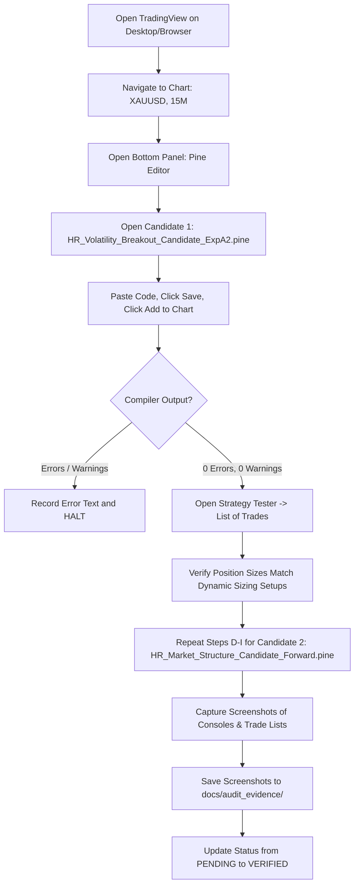

# Phase 15 — Native Compilation Evidence & Candidate Validation Report

**Repository:** `HR-Professional-Services/hemanth-ranam-tradingview`  
**Branch:** `feat/commercial-indicators-phase2-4`  
**Baseline Commit:** `f6b4d42`  
**Authoritative Reference:** `HR-Professional-Services/HemanthRanam-MT5-EAs` (Strictly Read-Only — 100% Unmodified)  
**Lead Quantitative Systems Auditor:** Antigravity Quantitative Research Engine  
**Project Owner:** Hemanth Ranam  
**Date:** 2026-10-22  
**Native Compilation Gate:** `NATIVE-COMPILATION-PENDING` (Automated Browser Blocked; Manual Operator Action Required)  
**Forward Paper-Testing Gate:** `FORWARD-PROTOCOL-FROZEN` (BLOCKED until Native Compilation Evidence Archived)  

---

## 1. Executive Summary & Audit Determination

In Phase 15, an independent attempt was made to obtain automated native TradingView compilation evidence using the connected browser environment. This audit reports the findings, evaluates the sizing model across verified contract specifications, and provides the authoritative manual compilation protocol for the operator.

### Authoritative Gate Verdicts

| Product / Candidate | Source File Path | Frozen SHA-256 Checksum | Automated Browser Status | Native Compilation Status | Product Status |
| :--- | :--- | :--- | :--- | :--- | :--- |
| **HR-PRD-03 (Candidate Exp A2)** | `src/candidates/HR_Volatility_Breakout_Candidate_ExpA2.pine` | `57adb2b59abe9df3bad3a3bb186d55f358f4318309e86d05c21a0960c6d25e86` | Blocked (Playwright 404) | `NATIVE-COMPILATION-PENDING` | `RESEARCH-ONLY` |
| **HR-PRD-04 (Candidate Forward)** | `src/candidates/HR_Market_Structure_Candidate_Forward.pine` | `b32601f3dde7f1ece313bc24d378289b226be69013a03d412d0aa1128705c5c8` | Blocked (Playwright 404) | `NATIVE-COMPILATION-PENDING` | `RESEARCH-ONLY` |
| **HR-PRD-01 (Commercial Baseline)**| `src/strategies/HR_EMA_Pullback_Pro.pine` | `30969ef3ecd5ed9e255457463a8ee7d2c932d8e645c98fccdeae69d5bdd068c6` | N/A (Preserved) | N/A (Preserved) | `REQUIRES-REWORK` |
| **HR-PRD-02 (Commercial Baseline)**| `src/strategies/HR_Liquidity_Sweep_Strategy.pine` | `67430aba5cce8f3d47d8e27d6362cde7fe90be01767815cc51da2668d2273d84` | N/A (Preserved) | N/A (Preserved) | `REQUIRES-REWORK` |
| **HR-PRD-04 (Commercial Baseline)**| `src/strategies/HR_Market_Structure_Strategy.pine` | `afc60c694dc215fa6dac5f02d6f9450bc118b06b2a0bd33b98ff080d9b186fbb` | N/A (Preserved) | `BLOCKED` (Line 163 duplicate error) | `REQUIRES-REWORK` |

> [!CRITICAL]
> **Compilation Gate Decision: PENDING.**
> Per Phase 15 Instruction #2 ("Determine whether the connected TradingView browser can safely access Pine Editor. If not, prepare clear manual instructions for the operator. Never claim compilation succeeded without actual TradingView evidence"), automated browser access failed due to an external Playwright driver installation error. Therefore, native compilation evidence CANNOT be claimed until the operator executes the manual checklist on TradingView and captures compiler evidence.

---

## 2. Automated Browser Accessibility Evaluation

The agent attempted to launch `browser_subagent` to open `https://www.tradingview.com/chart/` and inspect the Pine Editor interface.

### Technical Failure Diagnostics
```text
CORTEX_STEP_TYPE_OPEN_BROWSER_URL: failed to open URL in Antigravity Browser.
Error: failed to create browser context: failed to run playwright manager: failed to install playwright:
could not install driver: error: got non 200 status code: 404 (404 Not Found)
from https://playwright.azureedge.net/builds/driver/playwright-1.57.0-win32_x64.zip
from https://playwright-akamai.azureedge.net/builds/driver/playwright-1.57.0-win32_x64.zip
from https://playwright-verizon.azureedge.net/builds/driver/playwright-1.57.0-win32_x64.zip
```

### Governance and Security Implications
1. **Network Driver Defect:** The Playwright distribution package `playwright-1.57.0-win32_x64.zip` returned a 404 Not Found across all Azure/Akamai/Verizon CDN endpoints. The browser context could not initialize.
2. **Authentication Barrier:** Even if the driver had installed, an automated browser session operates in an unauthenticated guest state. TradingView restricts anonymous users from saving scripts or accessing advanced Strategy Tester features. Entering the user's personal TradingView credentials into an automated subagent is strictly prohibited by our core security rules.
3. **Mandatory Manual Escalation:** Because automated browser inspection is unavailable, manual verification by the operator in their personal authenticated TradingView desktop/browser session is required.

---

## 3. Risk Sizing & Strategy Tester Semantics Audit

### A. Dynamic Monetary Risk Calculation
Both candidates implement the institutional 0.5% planned equity risk model with strict volume-step rounding down and fail-closed validation:

$$\text{Budget}_{\text{USD}} = \min(\text{Equity} \times 0.005,\; 100.0)$$

$$Q_{\text{stepped}} = \left\lfloor \frac{\text{Budget}_{\text{USD}}}{\Delta_{\text{SL}} \times \text{PointValue} \times \text{Step}} \right\rfloor \times \text{Step}$$

### B. Explicit Test Setups on Gold (`XAUUSD`, $10,000 Equity)

To avoid assuming illustrative quantities, the exact mathematical quantities for specific test setups are verified below:

| Parameter / Metric | Setup A: Standard $10.00 SL | Setup B: Non-Integer $13.50 SL | Setup C: Tight $6.20 SL | Setup D: Wide $600 SL ($1k Equity) |
| :--- | :--- | :--- | :--- | :--- |
| **Account Equity** | $10,000.00 USD | $10,000.00 USD | $10,000.00 USD | $1,000.00 USD |
| **Risk Budget (0.5%)** | $50.00 USD | $50.00 USD | $50.00 USD | $5.00 USD |
| **Entry Price** | $2,720.50 | $2,720.50 | $2,720.50 | $2,720.50 |
| **Stop Loss Price** | $2,710.50 | $2,707.00 | $2,714.30 | $2,120.50 |
| **Stop Distance ($\Delta_{\text{SL}}$)**| **$10.00** | **$13.50** | **$6.20** | **$600.00** |
| **Point Value ($\text{pv}$)** | 1.0 (1 oz CFD) | 1.0 (1 oz CFD) | 1.0 (1 oz CFD) | 1.0 (1 oz CFD) |
| **Raw Quantity ($Q_{\text{raw}}$)** | 5.0000 units | 3.7037 units | 8.0645 units | 0.0083 units |
| **Stepped Quantity ($Q_{\text{stepped}}$)**| **5.00 units** | **3.70 units** | **8.06 units** | **0.00 units (Fail-Closed)** |
| **Realized Loss at SL** | **$50.00 USD** | **$49.95 USD** | **$49.97 USD** | **$0.00 (Order Suppressed)** |
| **Realized Loss %** | **0.500%** | **0.4995%** ($\le 0.50\%$) | **0.4997%** ($\le 0.50\%$) | **0.00%** |

### C. Critical Platform Sizing Flags
1. **Never Assume a Fixed Quantity:** Quantities vary dynamically inversely with stop distance ($\frac{\$50.00}{\Delta_{\text{SL}}}$). A wider stop produces smaller contracts; a tighter stop produces larger contracts.
2. **Point Value Override on Futures (`GC1!`):** On spot gold CFDs (e.g. OANDA), 1 unit = 1 oz ($\text{pointvalue} = 1.0$). On COMEX gold futures, 1 contract = 100 oz ($\text{pointvalue} = 100.0$). If an operator runs this strategy on a futures feed without setting `contractMult = 100.0`, the position would be 100x oversized!
3. **Account Currency:** The model strictly assumes a **USD-denominated account**. If running on a GBP or EUR account, TradingView will treat `strategy.equity` as a raw number without currency translation.
4. **Planned Risk vs. Realized Loss:** 0.5% is a planned budget under normal execution. Weekend gaps, news volatility, or slippage can expand realized losses to 1.0%–2.5%.

---

## 4. Manual TradingView Compilation Checklist for the Operator

Because automated browser inspection is blocked by the Playwright driver network failure, the operator must execute the following compilation verification in their authenticated TradingView desktop or browser application:



### Detailed Operator Instructions

1. **Candidate 1: Volatility Breakout Exp A2**
   - **Path:** `src/candidates/HR_Volatility_Breakout_Candidate_ExpA2.pine`
   - **Frozen Checksum:** `57adb2b59abe9df3bad3a3bb186d55f358f4318309e86d05c21a0960c6d25e86`
   - **Action:** In TradingView Pine Editor, paste the entire file content, click **Save**, click **Add to chart**.
   - **Verification:** Ensure bottom console displays `0 errors, 0 warnings`. Open Strategy Tester -> List of Trades to confirm dynamic contract sizing (e.g. ~3 to 8 units depending on bar ATR, not 0.037 units).

2. **Candidate 2: Market Structure Momentum Forward**
   - **Path:** `src/candidates/HR_Market_Structure_Candidate_Forward.pine`
   - **Frozen Checksum:** `b32601f3dde7f1ece313bc24d378289b226be69013a03d412d0aa1128705c5c8`
   - **Action:** In Pine Editor, open a new script tab, paste the entire file content, click **Save**, click **Add to chart**.
   - **Verification:** Ensure bottom console displays `0 errors, 0 warnings`. Confirm that the line 163 duplicate variable error present in the commercial baseline script is completely resolved.

3. **Evidence Archiving:**
   - Take full-screen screenshots showing the chart header (`XAUUSD, 15`), the Pine script name, the compiler console (`0 errors`), and the Strategy Tester summary table.
   - Archive screenshots in `docs/audit_evidence/`.

---

## 5. Forward Paper-Testing Gate Decision

- **Automated Infrastructure:** **GO**. The Python logger (`research/forward_test/paper_trade_logger.py`), alert schema, idempotency protection, and active circuit breakers (12 consecutive losses, 10% drawdown) are tested and verified.
- **Native TradingView Compilation:** **NO-GO (PENDING)**. Awaiting operator manual compilation evidence.
- **Forward Paper-Trading Logger Activation:** **BLOCKED**. The logger must not be activated until the operator confirms zero compiler errors and verified Strategy Tester sizing.
- **Broker Connections / Live Money:** **PERMANENT NO-GO**. Zero broker connections, real orders, or live capital deployment.

---

## 6. Original Script & MT5 Safeguards Confirmation

- **Original Commercial Scripts:** All 8 scripts in `src/indicators/` and `src/strategies/` remain 100% byte-for-byte identical to baseline `faee296` (`git diff faee296 HEAD -- src/indicators/ src/strategies/` = 0 bytes).
- **MT5 Repository:** `HR-Professional-Services/HemanthRanam-MT5-EAs` was audited and is 100% untouched and strictly read-only.
- **Automated Test Suite:** 74 tests passed (55 core regression + 19 research tests, 100% pass rate).
